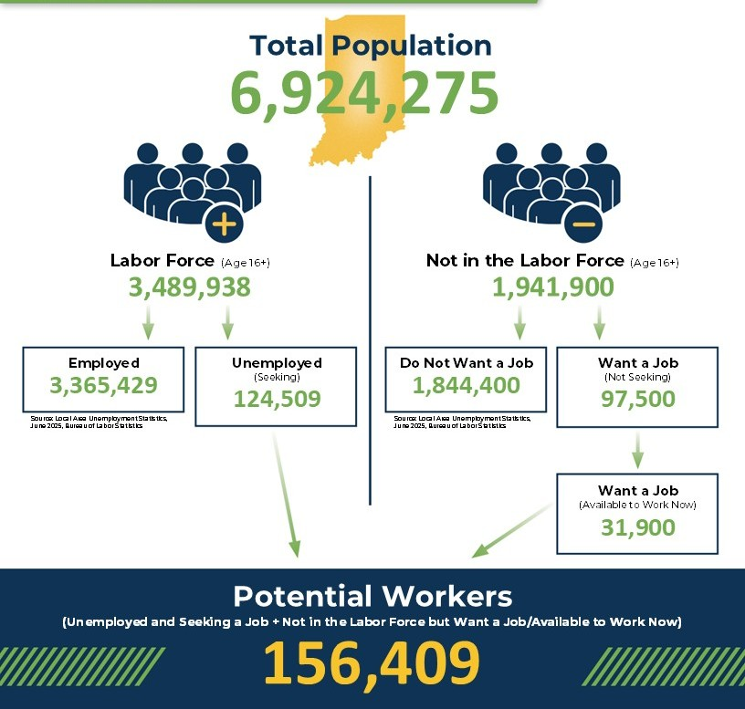

{width="800px"}

## 1. The Question That Bothered Me

When I first studied labor economics as an undergraduate, I was often confused by three terms: the **unemployment rate**, the **employment-population ratio**, and the **labor force participation rate**. What bothered me most was that the unemployment rate and the employment-population ratio did not add up to 100%. I thought employment and unemployment were two sides of the same coin. If someone is not unemployed, shouldn't they be employed?

The numbers made the puzzle even harder to ignore. According to the [U.S. Bureau of Labor Statistics (BLS)](https://www.bls.gov/cps/cpsaat05.htm), the 2025 annual average unemployment rate was 4.3%, while the employment-population ratio was 59.7%. Together, they add up to just 64%, far below 100%.

At first, I wondered whether I had misunderstood the definitions or missed something in the calculations. How could two rates that seem to describe opposite outcomes be so different? And why isn't the unemployment rate simply the opposite of the employment rate?

## 2. The Three Groups Behind the Rates

Let's start with four symbols:

- $E$: employed people
- $U$: unemployed people
- $N$: people not in the labor force
- $P$: the reference population used to calculate the rates

The labor force includes employed people and unemployed people:

$$
L = E + U
$$

Under the BLS definition, people are counted as unemployed if they do not have a job, are available to work, and have actively looked for work in the past four weeks. People on temporary layoff who expect to be called back are also counted as unemployed.

For the BLS Current Population Survey, the reference population $P$ is the civilian noninstitutional population age 16 and older. It excludes people in institutions and people on active duty in the military. 

People who are neither employed nor counted as unemployed are outside the labor force,which is denoted by $N$. This group can include students, retirees, people with caregiving responsibilities, and people who want a job but have not recently looked for one. 

So the reference population consists of the labor force and everyone outside it:

$$
P = L + N = (E + U) + N
$$

The three measures are calculated as follows:

| Measure | Formula | What it tells us |
|---|---|---|
| Unemployment rate (UR) | $\dfrac{U}{E+U}$ | Among people in the labor force, what share is unemployed? |
| Labor force participation rate (LFPR) | $\dfrac{E+U}{P}$ | What share of the reference population is working or actively looking for work? |
| Employment-population ratio (EPR) | $\dfrac{E}{P}$ | What share of the reference population is employed? |

The denominators are the key. The unemployment rate looks only at the labor force. The other two rates use the larger reference population.

## 3. How the Three Measures Fit Together

If we subtract the unemployment rate from 1, we get the share of the labor force that is employed:

$$
1 - \text{UR} = \frac{E}{E+U}
$$

That is not the share of the entire reference population that is employed. To get that, we also need to know what share of the population is in the labor force. This gives us a simple relationship:

$$
\text{EPR} = \text{LFPR} \times (1 - \text{UR})
$$

In terms of the underlying counts:

$$
\frac{E}{P}
=
\frac{E+U}{P}
\times
\frac{E}{E+U}
$$

The labor force participation rate tells us what share of the population is in the labor force. The term $1-\text{UR}$ tells us what share of the labor force is employed. Together, they give us the employment-population ratio.

This is why the three measures are related but not interchangeable. The unemployment rate is not the opposite of the employment-population ratio because the two rates use different denominators.

## 4. When Unemployment Falls but No One Gets a Job

A falling unemployment rate does not always mean that someone has found a job. For example, imagine a population of 100 people: 60 are employed, 5 are unemployed, and 35 are outside the labor force.

Now suppose one unemployed person stops actively looking for work after a long search. Since they are no longer actively looking, they are no longer counted as unemployed under the standard definition. They move out of the labor force, even though they have not found a job.

| Measure | Before | After |
|---|---|---|
| Employed | 60 | 60 |
| Unemployed | 5 | 4 |
| Not in the labor force | 35 | 36 |
| Unemployment rate | 7.69% | 6.25% |
| Employment-population ratio | 60% | 60% |
| Labor force participation rate | 65% | 64% |

The unemployment rate falls from 7.69% to 6.25%, but the number of people with jobs stays at 60. The employment-population ratio is unchanged, while the labor force participation rate falls from 65% to 64% because fewer people are in the labor force.

This example shows why the participation rate adds useful context. The unemployment rate tells us what is happening among people in the labor force, while the participation rate can reveal when people are entering or leaving it. Looking at all three measures gives us a fuller picture of what is happening in the labor market.

## 5. Conclusion

Economists track all three measures because each answers a different question. The unemployment rate tells us how many people in the labor force are unemployed. The employment-population ratio tells us what share of the reference population is working. The labor force participation rate tells us what share is working or actively looking for work.

It's best to read them together. A falling unemployment rate can be good news when it reflects people finding jobs. But the rate alone cannot tell us whether that is what happened. If the employment-population ratio stays the same while participation falls, the story may be different from what the headline unemployment rate suggests.

