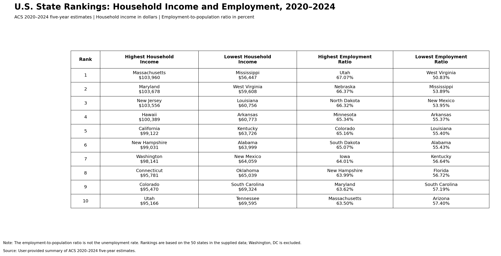
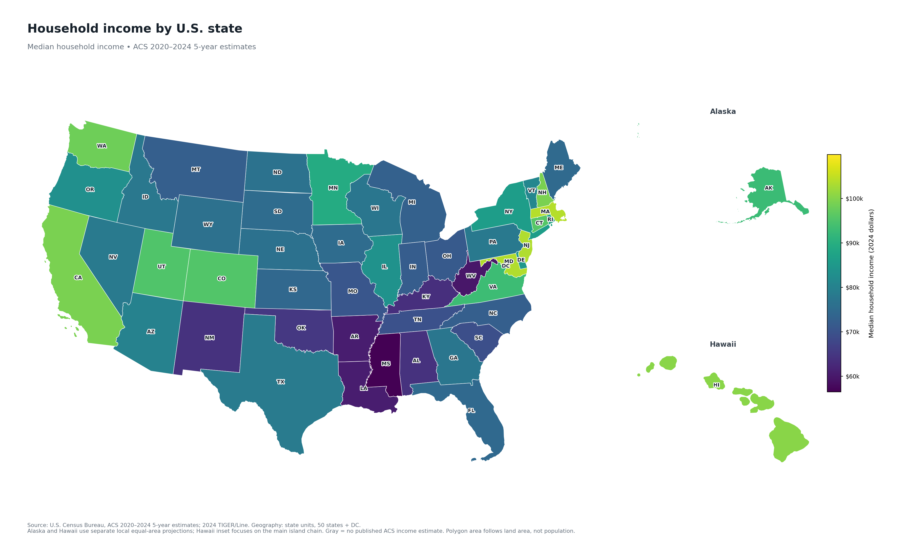
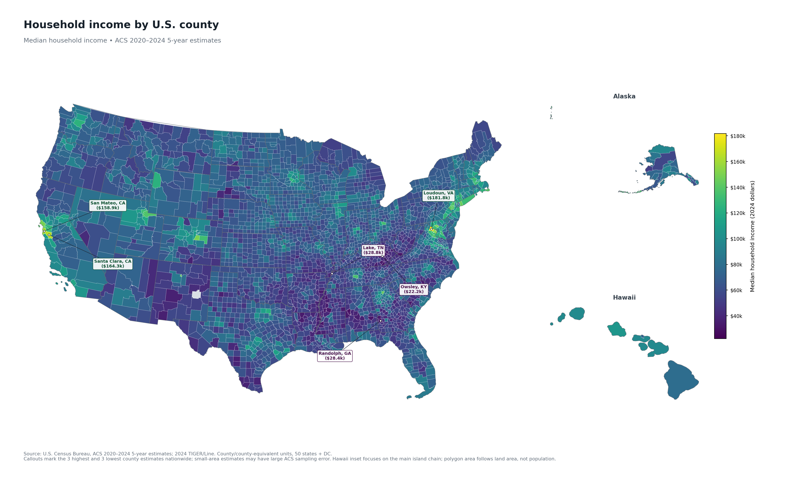
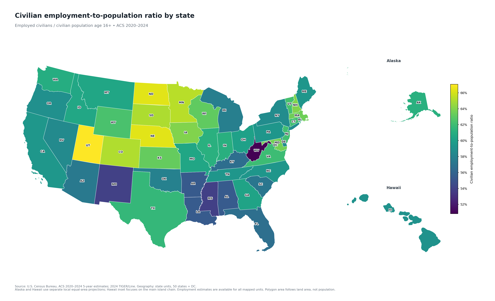
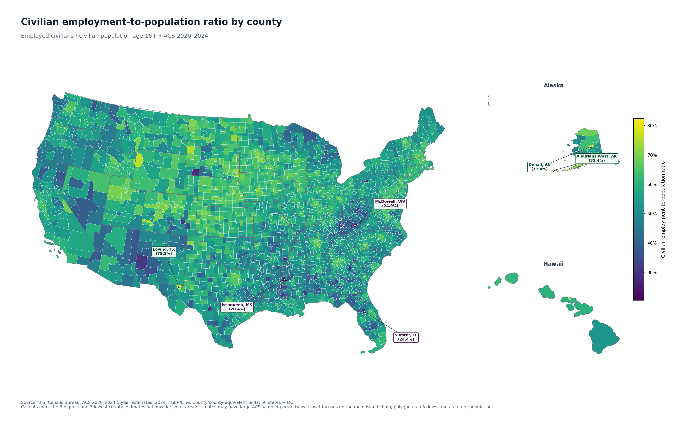
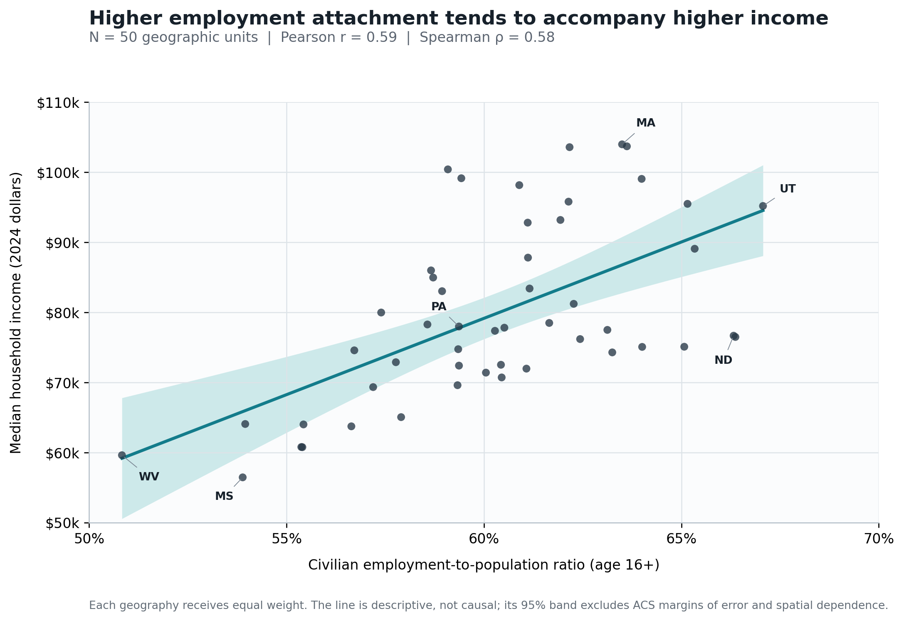
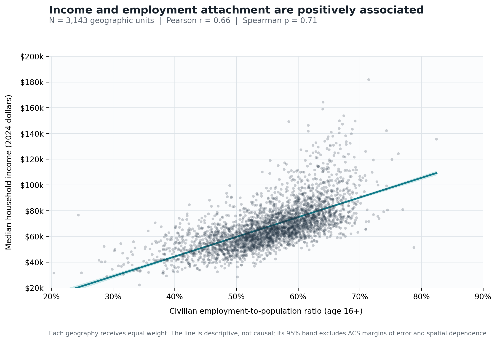

{width="800px"}

## 1. Question and Motivation

Employment and income are two important indicators of local economic well-being, but they capture different aspects of economic conditions. In reality, while developed areas often have both high household incomes and high employment rates, a place may still have a high share of adults employed without necessarily offering high-paying jobs.

This raises a natural question: **Are places with higher employment-to-population ratios also more likely to have higher median household incomes? And how are these two measures distributed geographically across the United States?**

To investigate this question, I examine state- and county-level data from the 2020–2024 American Community Survey (ACS) five-year estimates. I use GIS maps to identify regional patterns in household income and employment, then use scatterplots and correlation coefficients to assess the relationship between the two measures.

By combining spatial visualization with descriptive statistical analysis, this post explores whether income and employment tend to move together across places and where their geographic patterns differ.

## 2. Data and Methods

### Data Sources

I use the U.S. Census Bureau's **2020–2024 American Community Survey (ACS)** five-year estimates and **2024 TIGER/Line geographic boundaries**. The ACS estimates were released on January 29, 2026, and are based on data collected over the five-year period from January 1, 2020, through December 31, 2024. They describe conditions over this period rather than annual changes between 2020 and 2024.

The analysis covers the 50 states and Washington, DC, at the state level. At the county level, it uses 3,144 counties and county equivalents under the 2024 geographic definitions. One county-equivalent observation without a published income estimate is excluded from the county-level correlation analysis, leaving 3,143 observations with both measures available.

The analysis focuses on two variables:

1. `median household income`:

Median household income comes from ACS Table **B19013** and is measured in 2024 inflation-adjusted dollars. It represents the income level at the midpoint of the household income distribution. It is not an arithmetic average or an individual worker's wage.

2. `civilian employment-to-population ratio for people age 16 and older`:

The employment measure is the civilian employment-to-population ratio for people aged 16 and older. It is calculated as:

\frac{\text{Employed civilians aged 16+}}
{\text{Civilian population aged 16+}}
\times 100
]

The numerator is the number of employed civilians, and the denominator excludes Armed Forces personnel but includes civilians who are not in the labor force. This measure is therefore different from the unemployment rate, which uses the civilian labor force as its denominator.

The underlying data come from ACS Tables **B19013** and **B23025**.

### Data Processing and Statistical Methods

I combine the economic estimates with geographic boundary files using Census geographic identifiers (GEOIDs). Using standardized geographic identifiers rather than place names reduces the risk of incorrect matches. The data-processing script also checks for duplicate identifiers, missing estimates, and the expected number of geographic units before generating the maps.

For the relationship between income and employment, I calculate two correlation coefficients at each geographic level:

1. `Pearson's correlation coefficient` measures the strength and direction of a linear relationship between the two variables.

2. `Spearman's rank correlation coefficient` measures whether places with higher employment-to-population ratios also tend to rank higher in median household income.

Each state or county is treated as one observation, regardless of its population size. The analysis is therefore an equally weighted comparison of geographic units, not a population-weighted estimate of the relationship experienced by individual residents.

The scatterplots include fitted linear trend lines and conventional 95% confidence bands. These bands help visualize uncertainty around the fitted relationships, but they do not account for the sampling uncertainty of every ACS estimate or spatial dependence between neighboring areas. The correlations are descriptive statistics rather than causal estimates.

## 3. Data Visualization

{width="800px"}

The ranking table offers a quick preview of the map patterns: Massachusetts, Maryland, and New Jersey lead the state income rankings, while Mississippi, West Virginia, and Louisiana are at the bottom. The employment rankings look different, with Utah, Nebraska, and North Dakota near the top.

### Median household income by state

{width="800px"}
The first map highlights a familiar U.S. pattern: high household incomes cluster in the Northeast and along the Pacific Coast, while many states with lower medians are in the South and parts of Appalachia. In the data used here, Massachusetts has the highest state median household income ($103,960), followed by Maryland ($103,678) and New Jersey ($103,556). Mississippi is lowest ($56,447), followed by West Virginia ($59,608) and Louisiana ($60,756).

Why might these places look so different? Start with the jobs clustered around their biggest cities. The Boston area has universities, hospitals, life-science firms, and professional services, a mix reflected in Massachusetts' annual economic analysis. New Jersey sits between the New York and Philadelphia job markets and has a mix of corporate, pharmaceutical, finance, and logistics jobs. Maryland is close to Washington, DC, where federal agencies, contractors, research institutions, and technology employers are important. California has several large job centers, including the Bay Area's technology industry and the entertainment and professional-services sectors elsewhere in the state.

The point is not just that these places have jobs; many have a particularly large concentration of jobs that pay well. Big cities bring employers, specialized workers, universities, and suppliers close together. That can help firms grow and make it easier for workers with specialized skills to find high-paying work. The maps fit this explanation, but they do not tell us exactly how much each industry contributes to household income.

There is an important catch: high nominal income does not automatically mean a household can afford more. Housing and other living costs are especially high in some coastal job centers. The ACS income figures are adjusted for inflation over time, but not for differences in prices between states. The map shows where household incomes are high, not where each dollar necessarily goes the furthest.

The lower-income pattern also needs care. The South is not one uniform economy, and its large cities can look very different from its rural counties. Still, the broader Appalachian region continues to have lower incomes than the country overall: the Appalachian Regional Commission reports a 2020–2024 median household income of $66,555, about 82% of the national median of $80,734 (ARC income and poverty overview). Long-running differences in industry mix, access to high-wage employers, educational opportunities, and economic diversification may all matter, but these maps alone cannot tell us which factor is most important.

### Median household income by county

{width="800px"}

The county map makes the picture much less tidy. A state-level average can hide very different local economies, and the highest-income counties often sit near major employment centers rather than covering entire states.

Several high-income counties appear around the San Francisco Bay Area, including Santa Clara and San Mateo counties. This is the heart of Silicon Valley, where technology and other high-wage jobs are unusually concentrated. The Bay Area's regional planning agency reports that high-wage occupations—many of them in tech—have become increasingly concentrated in San Francisco and Silicon Valley (Bay Area jobs by wage level). This helps explain why household incomes in these counties stand out. It does not mean every resident works in tech, or that every household shares equally in the region's prosperity.

Loudoun County, Virginia, offers another example. Just outside Washington, DC, it is known for its “Data Center Alley.” The county says the growth of data centers has supported jobs in technology, construction, professional services, and security, alongside a broader economy that includes federal contracting, aerospace, health technology, and logistics (Loudoun County's account of its data center industry). Proximity to the nation's capital and a specialized technology infrastructure help make Loudoun different from a typical rural county.

At the other end of the map, Owsley County, Kentucky, appears among the lowest-income counties in the data. Its location in Appalachia makes the broader regional income gap relevant context, but the map cannot diagnose the county's economic history by itself. To explain a place like Owsley, we would need to look more closely at its industries, job access, education, demographics, and changes over time.

The main lesson from the two income maps is simple: geography matters, but scale matters too. The state map reveals broad regional patterns; the county map shows how much local economies can differ inside the same state.

### Civilian employment-to-population ratio by state

{width="800px"}

Here the map starts to tell a different story. The Great Plains and Upper Midwest stand out, with high ratios in states such as Nebraska, North Dakota, South Dakota, Minnesota, and Iowa. Utah also ranks first in the supplied data at 67.07%, followed by Nebraska at 66.37% and North Dakota at 66.32%. At the lower end are West Virginia (50.83%), Mississippi (53.89%), and New Mexico (53.95%).

A separate Bureau of Labor Statistics series points in a similar direction: in 2024, the West North Central division had an employment-to-population ratio of 64.5%, compared with 60.1% nationally (BLS state employment-to-population ratios). The BLS figures use annual averages, so they are not identical to this post's ACS five-year estimates, but they support the broader regional pattern.

Why can parts of the middle of the country have a high share of adults working without having the very highest household incomes? The first answer is simple: the two measures ask different questions. The employment ratio asks whether people have jobs, not how much those jobs pay. In the Great Plains and Upper Midwest, work spans agriculture, energy, manufacturing, transportation, health care, education, and local services. Those industries can support a high share of people in work, even if the region has fewer of the very highly paid jobs concentrated in places such as Silicon Valley or the Boston area. That is a plausible explanation for the pattern, not something these maps can prove on their own.

The denominator matters too. The ratio includes civilians aged 16 and older who are not in the labor force, including retirees and students. So it reflects population composition as well as job availability. A place with more people in working ages may have a higher ratio than a place with more retirees, even if their unemployment rates are similar.

It might be tempting to say people in the middle of the country simply “work harder,” but this measure cannot tell us that. It does not measure effort, hours worked, or work ethic. Looking at the local mix of jobs, age structure, and access to employment is a better starting point.

### Civilian employment-to-population ratio by county

{width="800px"}

At the county level, the employment map becomes patchier. Many counties in the central and northern parts of the country have relatively high ratios, while lower values appear in parts of the South and Appalachia. But there are exceptions in every broad region.

The displayed county estimates also include some extreme values—for example, 82.4% for Aleutians West Census Area, Alaska, and 20.4% for Issaquena County, Mississippi. These figures are worth noticing, but not taking at face value as precise rankings. Smaller populations can produce less stable survey estimates, and local age structure can strongly affect the ratio. Looking at ACS margins of error and other demographic characteristics would be the next step before explaining why an individual county stands out.

## Do income and employment move together?

{width="800px"}

The scatterplot brings the two stories together. There is a clear upward trend: states with higher employment-to-population ratios generally have higher median household incomes, although the dots are spread out rather than falling neatly along a line.

Across the 50 states, Pearson's correlation is 0.59 and Spearman's rank correlation is 0.58. Both indicate a moderate positive association. In plain English, states where a larger share of civilians aged 16 and older are employed tend to rank higher in household income too.

But the exceptions are revealing. California has one of the highest household income medians, yet its employment ratio is not among the highest. Utah, in contrast, ranks first in employment ratio and also has a relatively high median income. One state can have a lot of high-paid jobs; another can have a high share of adults working. Those are related, but not identical, strengths.

{width="800px"}

The county-level scatterplot also slopes upward. Among the 3,143 county and county-equivalent observations with both estimates, Pearson's correlation is 0.66 and Spearman's rank correlation is 0.71. The positive pattern persists at a finer geographic scale, but there is still substantial variation around the trend line. In other words, counties with higher employment ratios tend to rank higher in income, but knowing a county's employment ratio does not tell us its income with much precision.

The Spearman coefficient is a little higher than Pearson's, suggesting that the ranking of counties by employment and income moves together somewhat more consistently than a straight-line relationship would imply. It does not mean that employment has a stronger causal effect at the county level. County and state correlations use different geographic units and sample sizes, and each place receives equal weight. A small rural county counts as much as a large metropolitan county.

The scatterplots therefore support a broad conclusion, not a rule for every place. Employment is one part of household economic well-being, but it does not tell the whole story. Pay, working hours, the number of earners in a household, family size, and nonlabor income all affect median household income. Local industries, education, age structure, and housing costs add further layers.

## Interpretation and takeaway

I began with a simple expectation: places where more people work should also be places where households earn more. The data partly support that idea. Both the state and county comparisons show a positive relationship between employment-to-population ratios and median household income.

But the maps also show why the story is not that simple. High household incomes cluster around some of the country's major high-wage job centers, including the Northeast, California's Bay Area, and the Washington, DC, region. Meanwhile, high employment ratios appear in parts of the Great Plains and Upper Midwest, where having a job does not necessarily mean earning the same income as workers in high-wage metropolitan industries.

That contrast is the most interesting finding. A high share of people working and a high level of household income are related, but they are not interchangeable measures of prosperity. To understand why a particular state or county stands out, we would need to look beyond the map at wages, industry mix, education, demographics, commuting patterns, and local prices.

There are also limits to what this analysis can tell us. Median household income is adjusted for inflation, but not for differences in the cost of living across places. ACS five-year estimates pool responses collected over 2020–2024 and come with sampling uncertainty. The correlations do not incorporate each estimate's margin of error, and neighboring places may share economic conditions. Finally, these are geographic averages, not data on individual workers or households. They cannot show that employment causes higher income or identify the effects of any single industry or policy.