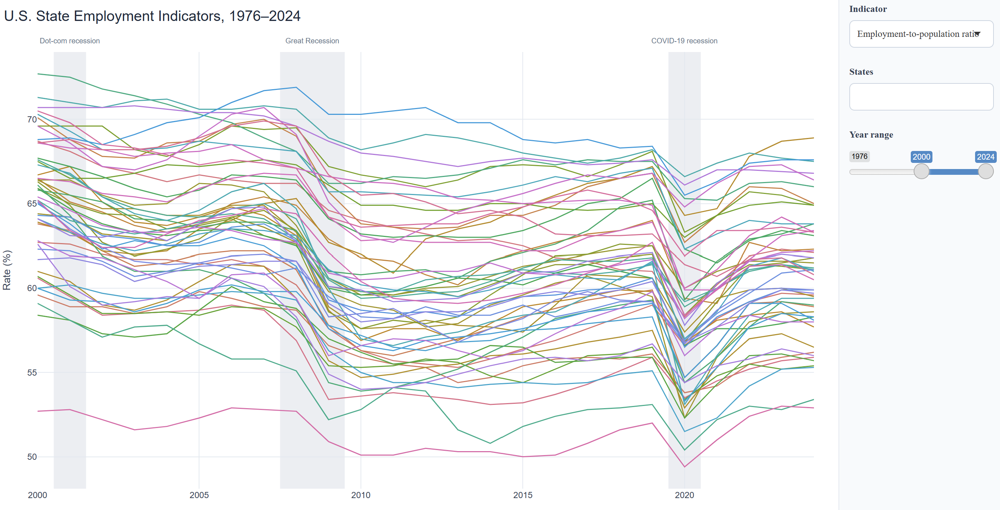
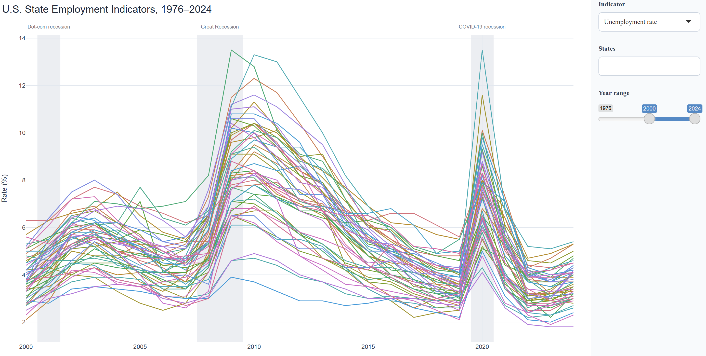
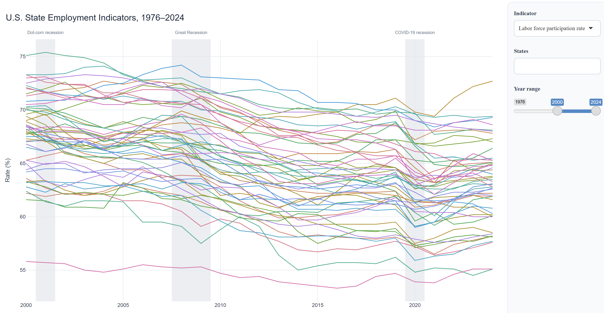

{width="800px"}


## 1. Question and Motivation


Employment conditions are not the same across the United States. A national unemployment rate can show whether the labor market is improving overall, but it can hide important differences between states. Some states may experience larger increases in unemployment during a recession, while others may recover more quickly.

This leads to my question:

> **How did employment indicators change across U.S. states from 1976 to 2024, and what do these changes tell us about recessions such as the Great Recession and COVID-19?**

I use an interactive visualization to compare three indicators, which are **unemployment rate, the labor force participation rate, and the employment-to-population ratio**. The goal is not only to show the national pattern, but also to let readers explore differences between states and inspect particular periods.


## 2. Data Processing


I use annual-average state labor market data published by the U.S. Bureau of Labor Statistics (**BLS**). The BLS provides annual state data on the employment status of the civilian noninstitutional population, with state series beginning in 1976. BLS documents the series and its methods on the [LAUS data page](https://www.bls.gov/lau/rdscnp16.htm). The workbook contains data through 2025; this analysis uses **1976–2024** and includes the **50 states and the District of Columbia**.

For this analysis, I restrict the timeframe to 1976–2024 and remove metropolitan-area observations so that the comparison includes only the 50 states and D.C. I also verify that all 51 jurisdictions have exactly one observation for each year in the analysis period.

The three indicators I used in this post are as below:

| Indicator | Definition | What it helps describe |
|:-----------------------|:-----------------------|:-----------------------|
| **Employment-to-population ratio** | Employed people ÷ civilian noninstitutional population age 16+ | The share of the population that is employed |
| **Labor-force participation rate** | Civilian labor force ÷ civilian noninstitutional population age 16+ | The share of the population that is working or actively looking for work |
| **Unemployment rate** | Unemployed people ÷ civilian labor force | The share of the labor force that is unemployed |

These measures answer different questions. The unemployment rate describes joblessness among people who are in the labor force. The participation rate shows how many people are working or actively seeking work. The employment-to-population ratio focuses on the share of the population that is currently employed.

The first two measures use the same population denominator. The unemployment rate uses only people in the labor force, so a low unemployment rate doesn't by itself mean that a high share of residents is employed. 


## 3. Interactive Visualization


The interactive graph below shows annual employment indicator values for the 50 states and D.C. Use **Indicator** to switch among the three measures, select one or more jurisdictions in **States**, and move the **Year range** slider to focus on a period. Hover over a line to see its jurisdiction, year, and rate.

The shaded bands mark three U.S. downturns: the 2001 recession, the 2007–2009 Great Recession, and the 2020 COVID-19 recession. The [National Bureau of Economic Research (NBER)](https://www.nber.org/research/data/us-business-cycle-expansions-and-contractions) dates these contractions to March–November 2001, December 2007–June 2009, and February–April 2020, respectively. Because the visualization uses annual averages, the bands provide calendar-year context rather than exact monthly recession windows. 


```{r prepare-employment-dashboard, include=FALSE}
analysis_root <- NULL
search_dir <- normalizePath(getwd(), winslash = "/", mustWork = TRUE)

for (attempt in seq_len(8)) {
  candidate <- file.path(dirname(search_dir), "Interactive-Data-Visualization")
  if (dir.exists(candidate)) {
    analysis_root <- normalizePath(candidate, winslash = "/", mustWork = TRUE)
    break
  }

  parent_dir <- dirname(search_dir)
  if (identical(parent_dir, search_dir)) break
  search_dir <- parent_dir
}

if (is.null(analysis_root)) {
  stop("Could not find the sibling Interactive-Data-Visualization project.")
}

viewer_option <- getOption("viewer")
options(viewer = function(...) invisible(NULL))
source(
  file.path(analysis_root, "code", "interactive_datapreparation.R"),
  local = knitr::knit_global(),
  echo = FALSE,
  print.eval = FALSE
)
options(viewer = viewer_option)

recovery_summary <- readr::read_csv(
  file.path(analysis_root, "results", "employment_population_recovery_2019_2024.csv"),
  show_col_types = FALSE
)

median_series <- state_data |>
  dplyr::group_by(Year) |>
  dplyr::summarise(
    epr = median(EmploymentPopulationRatio, na.rm = TRUE),
    lfpr = median(LaborForceRate, na.rm = TRUE),
    unemployment = median(UnemploymentRate, na.rm = TRUE),
    .groups = "drop"
  )

metric_median <- function(metric, year) {
  median_series[[metric]][median_series$Year == year]
}

state_recovery <- recovery_summary |>
  dplyr::filter(Area %in% state.name)

states_below_count <- sum(!state_recovery$recovered_to_2019)
states_recovered_count <- sum(state_recovery$recovered_to_2019)

recession_windows <- tibble::tribble(
  ~Episode, ~baseline_year, ~response_start, ~response_end,
  "2001 recession", 2000L, 2001L, 2003L,
  "Great Recession", 2007L, 2008L, 2011L,
  "COVID-19 recession", 2019L, 2020L, 2020L
)

recession_summary <- dplyr::bind_rows(lapply(seq_len(nrow(recession_windows)), function(i) {
  window <- recession_windows[i, ]
  baseline <- median_series |>
    dplyr::filter(Year == window$baseline_year)
  response <- median_series |>
    dplyr::filter(Year >= window$response_start, Year <= window$response_end)
  epr_low <- response |> dplyr::slice_min(epr, n = 1, with_ties = FALSE)
  lfpr_low <- response |> dplyr::slice_min(lfpr, n = 1, with_ties = FALSE)
  unemployment_peak <- response |> dplyr::slice_max(unemployment, n = 1, with_ties = FALSE)

  tibble::tibble(
    Episode = window$Episode,
    EPR = sprintf("%.1f%% → %.1f%% (%d)", baseline$epr, epr_low$epr, epr_low$Year),
    LFPR = sprintf("%.1f%% → %.1f%% (%d)", baseline$lfpr, lfpr_low$lfpr, lfpr_low$Year),
    Unemployment = sprintf(
      "%.1f%% → %.1f%% (%d)", baseline$unemployment,
      unemployment_peak$unemployment, unemployment_peak$Year
    )
  )
}))

peak_state <- function(start_year, end_year) {
  state_data |>
    dplyr::filter(
      Area %in% state.name,
      Year >= start_year,
      Year <= end_year
    ) |>
    dplyr::slice_max(UnemploymentRate, n = 1, with_ties = FALSE) |>
    dplyr::transmute(result = sprintf("%s (%d, %.1f%%)", Area, Year, UnemploymentRate)) |>
    dplyr::pull(result)
}


dc_values <- state_data |>
  dplyr::filter(Area == "District of Columbia", Year %in% c(2019, 2024))
dc_2019 <- dc_values$EmploymentPopulationRatio[dc_values$Year == 2019]
dc_2024 <- dc_values$EmploymentPopulationRatio[dc_values$Year == 2024]
dc_change_pp <- dc_2024 - dc_2019
```

<iframe
  src="interactive-graph.html"
  title="Interactive U.S. state employment indicators, 1976–2024"
  width="100%"
  height="900"
  style="border: 0; display: block; width: 96vw; max-width: 1800px; position: relative; left: 50%; transform: translateX(-50%);">
</iframe>


## 4. What the Data Show


### (1) Recessions bring higher unemployment and lower employment


Onepattern that stands out when moving between states is that unemployment rates tend to rise while mployment-to-population ratio (EPR) falls across the three downturns. This makes sense given that businesses may reduce hiring or cut jobs during a broad downturn, and more people may be looking for work without finding it.

State differences make the downturns more concrete. During the Great Recession, Michigan recorded the highest state unemployment rate in 2009, at 13.6 percent. In the 2020 annual data, Nevada had the highest unemployment rate among states in US.

{width="800px"}

{width="800px"}

As the graph shows, the labor force participation rate (LFPR) also declines in many states around these episodes, although its movement is generally less dramatic than the rise in unemployment or the drop in the employment-to-population ratio. LFPR measures the share of the civilian noninstitutional population age 16 and older that is either employed or actively looking for a job.

This distinction matters. A person who does not have a job but is actively searching is counted as unemployed. If that person stops actively looking for work, they are no longer counted as unemployed; they are classified as outside the labor force. As a result, the unemployment rate can fall even when some people have not found jobs but have stopped searching. Looking at unemployment alongside LFPR and the employment-to-population ratio helps avoid interpreting a lower unemployment rate as a full recovery on its own.

{width="800px"}


### (2) The 2024 employment ratio remained below 2019 in most states


The second comparison focuses on the years immediately before the pandemic(2019) and the latest year in this dataset(2024). I subtract each state's 2019 employment-to-population ratio from its 2024 value and a negative change means that a smaller share of the civilian noninstitutional population was employed in 2024 than in 2019. 

The five largest declines in the data are **Maryland, New Hampshire, Iowa, Wyoming, and Maine**. **Maryland** had the largest drop, from 66.5 percent in 2019 to 63.1 percent in 2024, a decline of **3.4** percentage points. **New Hampshire and Iowa** followed closely, with declines of **3.3** and **3.2** percentage points. **Wyoming** fell by **2.4** points, and **Maine** by **2.3** points.


By 2024, **`r states_below_count` of 50 states** had an EPR below their own 2019 level. The five largest declines were:

```{r state-recovery-table, echo=FALSE}
state_recovery |>
  dplyr::slice_min(change_percentage_points, n = 5, with_ties = FALSE) |>
  dplyr::transmute(
    State = Area,
    ratio_2019 = round(ratio_2019, 1),
    ratio_2024 = round(ratio_2024, 1),
    change = round(change_percentage_points, 1)
  ) |>
  knitr::kable(
    col.names = c("State", "2019 ratio (%)", "2024 ratio (%)", "Change (percentage points)"),
    caption = "Five states with the largest 2019–2024 declines in the employment-to-population ratio"
  )
```

The following **`r states_recovered_count` states** had returned to or exceeded their 2019 EPR by 2024:

```{r recovered-states-table, echo=FALSE}
state_recovery |>
  dplyr::filter(recovered_to_2019) |>
  dplyr::arrange(change_percentage_points) |>
  dplyr::transmute(
    State = Area,
    ratio_2019 = round(ratio_2019, 1),
    ratio_2024 = round(ratio_2024, 1),
    change = round(change_percentage_points, 1)
  ) |>
  knitr::kable(
    col.names = c("State", "2019 ratio (%)", "2024 ratio (%)", "Change (percentage points)"),
    caption = "States at or above their 2019 employment-to-population ratio in 2024"
  )
```

D.C. is not included in the count of 50 states. Its EPR changed from **`r sprintf("%.1f%%", dc_2019)`** in 2019 to **`r sprintf("%.1f%%", dc_2024)`** in 2024, a change of **`r sprintf("%.1f", dc_change_pp)` percentage points**. 


### (3) Only 11 states had returned to or exceeded their 2019 employment-to-population ratio by 2024


The interactive graph also shows that the recovery was not the same in every state. Using the rule that a state is considered to have returned to its pre-pandemic level when its 2024 ratio is at least as high as its 2019 ratio, 11 states meet that threshold in this dataset: **Alabama, New York, Arkansas, New Mexico, Mississippi, Texas, Arizona, Oregon, West Virginia, Alaska, and Oklahoma**.

**Oklahoma** recorded the largest increase relative to 2019, followed by **Alaska** and **West Virginia**. **Alabama** and **New York** were essentially unchanged at the one-decimal precision shown in the table. 

Taken all the findings above together, we can see that the three recessions differ in duration and severity. The 2001 recession shows a milder, more gradual adjustment in annual data than the Great Recession or the abrupt COVID-19 shock. The Great Recession's labor-market effects persist into the years after the NBER-dated contraction. The COVID-19 shock is concentrated in 2020, followed by substantial—but uneven—improvement.


## 5. What Do These Results Tell Us?


The interactive visualization reveals three main patterns.

*First, major recessions are clearly reflected in the graph.* During downturns, unemployment rates generally rise, while employment-to-population ratios fall. These changes show that downturns affect both people looking for work and the share of the population that is employed, although the size of the impact varies across states.

*Second, the labor force participation rate helps explain what the unemployment rate alone may miss.* When people stop actively looking for work, they are no longer counted as unemployed because they have left the labor force. As a result, unemployment can fall even when some people remain out of work. Looking at the labor force participation rate and the employment-to-population ratio alongside unemployment provides a more complete picture of labor market conditions.

*Finally, the comparison between 2019 and 2024 shows that the recovery after COVID-19 was uneven.* By 2024, 11 states had returned to or exceeded their 2019 employment-to-population ratio. In contrast, Maryland, New Hampshire, Iowa, Wyoming, and Maine had the largest declines over this period. These differences are easy to miss when looking only at national trends. The interactive graph allows readers to compare individual states, focus on specific periods, and explore how labor market recovery differed across the country.


