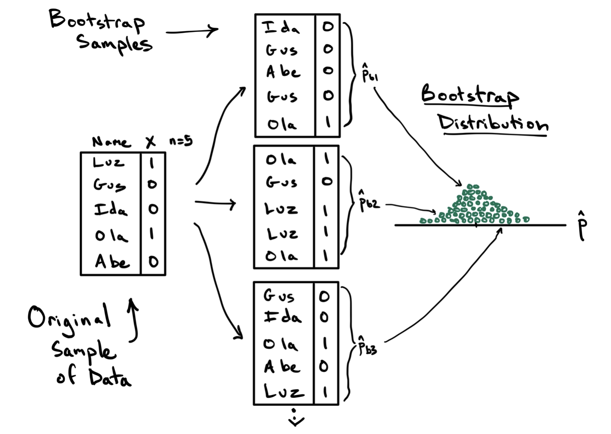

```{r setup, include=FALSE}
# If the script is outside this project folder, enter its relative or absolute
# path here. Leave as "" to let the code search the project folders below.
BOOTSTRAP_SCRIPT_PATH <- ""

# Identify the folder containing this QMD file.
input_file <- knitr::current_input()
if (is.null(input_file) || length(input_file) == 0 || is.na(input_file[1]) || !nzchar(input_file[1])) {
  document_dir <- normalizePath(getwd(), winslash = "/", mustWork = TRUE)
} else {
  input_path <- normalizePath(input_file[1], winslash = "/", mustWork = FALSE)
  document_dir <- if (file.exists(input_path)) {
    dirname(input_path)
  } else {
    normalizePath(getwd(), winslash = "/", mustWork = TRUE)
  }
}

# Search the QMD folder, its parent folders, and the current working directory.
# This also finds the R script when it is stored in a separate folder elsewhere
# inside the same project.
get_parent_folders <- function(path, max_levels = 6L) {
  folders <- character()
  current <- normalizePath(path, winslash = "/", mustWork = TRUE)

  for (i in seq_len(max_levels + 1L)) {
    folders <- c(folders, current)
    parent <- dirname(current)
    if (identical(parent, current)) break
    current <- parent
  }

  unique(folders)
}

search_roots <- unique(c(
  get_parent_folders(document_dir),
  get_parent_folders(getwd())
))

# First honor a manually supplied path, when one is needed.
script_path <- NULL
if (nzchar(BOOTSTRAP_SCRIPT_PATH)) {
  manual_path <- path.expand(BOOTSTRAP_SCRIPT_PATH)
  is_absolute_path <- startsWith(manual_path, "/") ||
    grepl("^[A-Za-z]:", manual_path) || startsWith(manual_path, "\\\\")

  if (!is_absolute_path) {
    manual_path <- file.path(getwd(), manual_path)
  }

  if (file.exists(manual_path)) {
    script_path <- normalizePath(manual_path, winslash = "/", mustWork = TRUE)
  } else {
    stop(paste("BOOTSTRAP_SCRIPT_PATH does not exist:", manual_path))
  }
}

# If no manual path was supplied, search recursively. Search nearer folders
# first and stop as soon as the exact filename is found.
if (is.null(script_path)) {
  for (search_root in search_roots) {
    matches <- tryCatch(
      list.files(
        path = search_root,
        pattern = "^bootstrap_and_stimulation[.]R$",
        recursive = TRUE,
        full.names = TRUE,
        all.files = FALSE,
        include.dirs = FALSE
      ),
      error = function(e) character()
    )

    if (length(matches) > 0) {
      # Ignore common generated or dependency folders if they happen to
      # contain a copy of the script.
      normalized_matches <- gsub("\\\\", "/", matches)
      excluded <- grepl(
        "/(renv|node_modules|_site|_freeze|[.]quarto|[.]git)/",
        normalized_matches
      )
      matches <- matches[!excluded]
    }

    if (length(matches) > 0) {
      # Prefer a conventional code/R/scripts folder if there are multiple copies.
      normalized_matches <- gsub("\\\\", "/", matches)
      preferred <- grepl(
        "/(code|R|scripts)/bootstrap_and_stimulation[.]R$",
        normalized_matches
      )
      matches <- matches[order(!preferred, nchar(matches))]
      script_path <- normalizePath(matches[1], winslash = "/", mustWork = TRUE)
      break
    }
  }
}

if (is.null(script_path)) {
  stop(paste(
    "Cannot find bootstrap_and_stimulation.R in the QMD folder, its parent folders,",
    "or their project subfolders.",
    "If the script is outside this project, set BOOTSTRAP_SCRIPT_PATH near the top",
    "of this setup chunk to its relative or absolute path."
  ))
}

# Run the original simulation script in Quarto's document environment.
# The script creates the simulation objects and its PROJECT_ROOT/figures folder.
source(script_path, local = knitr::knit_global())

# Create the single rows referenced by inline R expressions below.
bootstrap_ci_95 <- bootstrap_ci[
  abs(bootstrap_ci$confidence_level - 0.95) < 1e-8,
  , drop = FALSE
]

coverage_n25 <- coverage_results[
  coverage_results$sample_size == 25 &
    abs(coverage_results$confidence_level - 0.95) < 1e-8,
  , drop = FALSE
]

critical_05 <- critical_values[
  abs(critical_values$alpha - 0.05) < 1e-8,
  , drop = FALSE
]

if (nrow(bootstrap_ci_95) != 1 || nrow(coverage_n25) != 1 || nrow(critical_05) != 1) {
  stop("The simulation script did not create the expected summary rows.")
}

# Copy the HTML widgets and their companion dependency folders next to this QMD.
script_figures_dir <- file.path(PROJECT_ROOT, "figures")
document_figures_dir <- file.path(document_dir, "figures")
if (!dir.exists(document_figures_dir)) {
  dir.create(document_figures_dir, recursive = TRUE, showWarnings = FALSE)
}

figure_files <- c(
  "bootstrap_confidence_interval.html",
  "bootstrap_distribution.html",
  "bootstrap_parameters.html",
  "coverage_simulation.html",
  "null_distribution.html"
)

if (!dir.exists(script_figures_dir)) {
  stop(paste("The simulation script did not create its figures/ directory:", script_figures_dir))
}

for (figure_name in figure_files) {
  source_figure <- file.path(script_figures_dir, figure_name)
  if (!file.exists(source_figure)) {
    stop(paste("Expected figure was not created:", source_figure))
  }

  destination_figure <- file.path(document_figures_dir, figure_name)
  source_normalized <- normalizePath(source_figure, winslash = "/", mustWork = TRUE)
  destination_normalized <- normalizePath(destination_figure, winslash = "/", mustWork = FALSE)

  if (!identical(source_normalized, destination_normalized)) {
    file.copy(source_figure, destination_figure, overwrite = TRUE)
  }

  dependency_name <- paste0(tools::file_path_sans_ext(figure_name), "_files")
  source_dependency <- file.path(script_figures_dir, dependency_name)
  if (dir.exists(source_dependency)) {
    destination_dependency <- file.path(document_figures_dir, dependency_name)
    if (!identical(
      normalizePath(source_dependency, winslash = "/", mustWork = TRUE),
      normalizePath(destination_dependency, winslash = "/", mustWork = FALSE)
    )) {
      file.copy(
        source_dependency,
        document_figures_dir,
        recursive = TRUE,
        overwrite = TRUE
      )
    }
  }
}
```

{width="800px"}

## 1. Why do we need simulation and resampling?

Many questions in economics are about populations. For example, we may want to know the average salary of all employees in a department or whether a policy improves people's income. Ideally, we would collect data from everyone in the population. In reality, however, this is often too expensive or simply impossible. We usually have to use a sample to estimate characteristics of the whole population.

But a sample only provides part of the picture. **How can we tell whether our estimates are reliable? How can we decide whether an observed difference is statistically meaningful?**

This is where simulation and resampling become useful. In this post, I use **computer simulations to show how two important methods(confidence intervals and hypothesis testing) in econometrics work**.

First, I use a simulated department salary survey to show how to construct a bootstrap confidence interval from one sample. I then use repeated sampling to examine how often confidence intervals contain the true population mean. Finally, I simulate 10,000 coin-flipping experiments to build a null distribution and explain how rejection regions and p-values help us make statistical decisions.The table below summarizes the three experiments.

## 2. Constructing a bootstrap confidence interval from one sample


Suppose we want to estimate the average salary of employees in a department and salary values are measured in thousands of dollars. It's hard for us to have information about every employee, so we randomly select 25 employees from the department. Besides, we know their salaries follow a Normal distribution with a true mean of $\mu = 100$ and a standard deviation of $\sigma = 20$. 

The mean of our sample is **`r sprintf("%.2f", sample_mean)`**, and its standard deviation is **`r sprintf("%.2f", sample_sd)`**. The problem is that we only have one sample. We don't know how much the sample mean might change if we selected a different group of 25 employees. To solve it, we can use **bootstrap** to study this uncertainty without collecting another sample from the population.

This is how **bootstrap** works. We treat the 25 observed salaries as a stand-in for the population,and then draw 1,000 new samples from these 25 observations. Each new sample also contains 25 observations, and we calculate its mean. Because we sample with replacement, the same salary may appear more than once in a bootstrap sample, while another salary may not appear at all.

The 1,000 bootstrap means form a **bootstrap distribution**. The standard deviation of these bootstrap means is the bootstrap standard error, which is **`r sprintf("%.2f", bootstrap_se)`**. We use the 5th, 2.5th, and 0.5th percentiles and their corresponding upper percentiles to construct 90%, 95%, and 99% percentile confidence intervals.

The table below reports the confidence intervals from our original sample.

```{r bootstrap-ci-table, echo=FALSE}
bootstrap_ci_display <- data.frame(
  `Confidence level` = sprintf("%.0f%%", 100 * bootstrap_ci$confidence_level),
  `Lower endpoint` = sprintf("%.2f", bootstrap_ci$lower),
  `Upper endpoint` = sprintf("%.2f", bootstrap_ci$upper),
  `Interval width` = sprintf("%.2f", bootstrap_ci$width),
  check.names = FALSE
)

knitr::kable(bootstrap_ci_display, align = "r")
```

A higher confidence level produces a wider interval because it needs to include more of the bootstrap distribution. In the interactive graph below, the dropdown menu lets you switch among the 90%, 95%, and 99% confidence intervals. The green bars show bootstrap means inside the selected interval, while the red bars show values outside it. The vertical lines mark the original sample mean and the true population mean.

<iframe
  src="figures/bootstrap_confidence_interval.html"
  title="Bootstrap distribution with selectable confidence intervals"
  width="100%"
  height="680"
  style="border: 0; display: block; width: 96vw; max-width: 1800px; position: relative; left: 50%; transform: translateX(-50%);">
</iframe>

For this one sample, the 95% bootstrap confidence interval **`r if (bootstrap_ci_95$lower <= POP_MEAN && POP_MEAN <= bootstrap_ci_95$upper) "contains" else "does not contain"`** the known population mean of 100. This is useful for checking the method in our simulation. In a real application, however, the true population mean is unknown, so we cannot directly check whether one estimated interval contains it.

## 3. Does the number of bootstrap resamples matter?

The next graph keeps the original sample of 25 salaries fixed but changes the number of bootstrap resamples. The script compares 250, 1,000, and 5,000 resamples. Use the dropdown menu to view all three distributions or one at a time.

<iframe
  src="figures/bootstrap_distribution.html"
  title="Bootstrap distributions under different numbers of resamples"
  width="100%"
  height="680"
  style="border: 0; display: block; width: 96vw; max-width: 1800px; position: relative; left: 50%; transform: translateX(-50%);">
</iframe>

Increasing the number of resamples does not give us more original data or change the sample of 25 employees. Instead, it gives us more bootstrap means to estimate the bootstrap distribution. With more resamples, the histogram generally gives a smoother picture of that distribution. The vertical lines mark the original sample mean and the true population mean.


## 4. What does a 95% confidence interval mean?

A 95% confidence interval does not mean that there is a 95% probability that the true population mean is inside one particular interval. The population mean is fixed, but the sample we draw changes each time. As a result, the sample mean and the confidence interval also change from sample to sample.

To understand this idea, we can repeat the sampling process many times and check how often the resulting intervals contain the true population mean.

In this experiment, I simulate 10,000 independent samples for each of four sample sizes: 10, 25, 50, and 100. Each sample is drawn from the same Normal population, with a true mean of $\mu = 100$ and a standard deviation of $\sigma = 20$. For every sample, I construct confidence intervals at three levels: 90%, 95%, and 99%. I then check whether each interval contains the true population mean of 100.

Since we know the population standard deviation in this simulation, we can calculate the standard error as $\sigma / \sqrt{n}$. The confidence interval is:

$$
\bar{x} \pm z_{1-\alpha/2}\frac{\sigma}{\sqrt{n}}.
$$

For example, when the sample size is 25, the standard error is $20 / \sqrt{25} = 4$. For a 95% confidence interval, the critical value is 1.96, so the interval extends approximately $1.96 \times 4 = 7.84$ units on either side of the sample mean.

After repeating the process 10,000 times, we calculate the empirical coverage rate: the percentage of confidence intervals that contain the true population mean. For a sample size of 25, **`r format(coverage_n25$covered_intervals, big.mark = ",")` out of 10,000 intervals** contain the true mean. This gives an empirical coverage rate of **`r sprintf("%.2f%%", coverage_n25$coverage_percent)`**. Therefore, when we repeatedly draw new samples and construct 95% confidence intervals using the same method, approximately 95% of those intervals contain the true population mean.

The simulation also allows us to compare different confidence levels. The table below reports the empirical coverage rates and average interval widths for all three confidence levels across the four sample sizes.


```{r coverage-all-levels-table, echo=FALSE}
coverage_display <- data.frame(
  `Sample size` = coverage_results$sample_size,
  `Confidence level` = sprintf("%.0f%%", 100 * coverage_results$confidence_level),
  `Empirical coverage` = sprintf("%.2f%%", coverage_results$coverage_percent),
  `Average interval width` = sprintf("%.2f", coverage_results$average_interval_width),
  check.names = FALSE
)

knitr::kable(coverage_display, align = "r")
```

## 5. Hypothesis testing: rejection regions and p-values

### 5.1  Hypothesis testing

In the previous sections, we used simulation to understand how confidence intervals work. Now, let's look at another important question in econometrics: **how can we use sample data to test a claim about a population?**

Imagine flipping a coin 100 times and getting 62 heads. Is this result just a result of random chance, or does it suggest that the coin may be biased?

To answer this question, we set up two hypotheses:

- **Null hypothesis ($H_0$):**  $p = 0.5$ (The coin is fair)
- **Alternative hypothesis ($H_1$):**  $p \neq 0.5$ (The probability of heads is different from 0.5)

Under the null hypothesis, we know the number of heads in 100 flips follows a Binomial distribution
:

$$
X \sim \text{Binomial}(100, 0.5).
$$


The expected number of heads is:


$$
E(X) = np = 100 \times 0.5 = 50.
$$


In other words, if the coin is fair, we would expect to get around 50 heads in 100 flips. However, random variation means that we will not always get exactly 50.

To understand what outcomes we might expect from a fair coin, I simulate 10,000 experiments, with 100 coin flips in each experiment. The distribution of the simulated head counts is called the null distribution. It shows how the number of heads would vary if the null hypothesis were true.

Our observed result is 62 heads, which is 12 more than the expected number of 50. Since we are conducting a two-sided test, we also need to consider results that are equally far from 50 in the opposite direction. Therefore, outcomes of 38 or fewer heads and 62 or more heads are both considered at least as extreme as our observed result.

Based on the 10,000 simulations, the estimated two-sided p-value is r sprintf("%.4f", monte_carlo_p). I also calculate the exact p-value using R's binom.test() function, which is r sprintf("%.4f", exact_two_sided_p). The two values should be close, although they may differ slightly because the simulation uses a finite number of repetitions.

One small detail worth mentioning is that I use the adjustment `(extreme_count + 1) / (B_NULL + 1)` to estimate the p-value. This avoids getting a simulated p-value of exactly zero when none of the simulations produces an equally extreme result.

### 5.2 Rejection region

The null distribution tells us what outcomes are possible if the coin is fair. But how do we decide whether an observed result is unusual enough to reject the null hypothesis?

This is where the rejection region comes in. Before looking at the observed result, we choose a significance level, $\alpha$, which sets the maximum Type I error rate we are willing to accept as our target. A Type I error occurs when we reject a true null hypothesis. For example, setting $\alpha = 0.05$ means we use a 5% significance level.

Using the exact $\text{Binomial}(100, 0.5)$ distribution, we calculate the lower and upper critical values for significance levels of 10%, 5%, and 1%. These critical values define the rejection regions: if the observed number of heads falls outside the critical bounds, we reject the null hypothesis.

The table below summarizes the critical values and the actual probability of falling in each rejection region when the coin is fair.


```{r rejection-critical-values-table, echo=FALSE}
critical_values_display <- data.frame(
  `Significance level` = sprintf("%.0f%%", 100 * critical_values$alpha),
  `Reject when heads are at or below` = critical_values$lower_critical,
  `Reject when heads are at or above` = critical_values$upper_critical,
  `Actual rejection probability under H0` = sprintf(
    "%.2f%%", 100 * critical_values$actual_null_rejection_probability
  ),
  check.names = FALSE
)

knitr::kable(critical_values_display, align = "r")
```


At the 5% significance level, the lower critical value is **`r critical_05$lower_critical`** and the upper critical value is **`r critical_05$upper_critical`**. Therefore, we reject the null hypothesis when the number of heads is 39 or fewer, or 61 or more. Our observed result of 62 heads falls inside this rejection region, so we reject $H_0$ at the 5% level.


### 5.3 P-value: measure how unusual the observed result is

The p-value looks at the same problem from a different angle. Instead of starting with a significance level, we start with our observed result of 62 heads and ask: If the coin were actually fair, how likely would we be to observe 62 or more heads

In our example, the exact p-value is **`r sprintf("%.4f", exact_two_sided_p)`**, which is below 0.05.  Since it is smaller than 0.05, the observed result is unlikely to occur by chance alone under the assumption of a fair coin. We therefore reject the null hypothesis at the 5% significance level.

The interactive graph below brings the rejection region and p-value together. Use the dropdown menu to switch between significance levels of 10%, 5%, and 1%.

<iframe
  src="figures/null_distribution.html"
  title="Simulated null distribution with rejection regions and p-value tails"
  width="100%"
  height="700"
  style="border: 0; display: block; width: 96vw; max-width: 1800px; position: relative; left: 50%; transform: translateX(-50%);">
</iframe>

One important thing to remember is that the p-value is not the probability that the null hypothesis is true. It is calculated under the assumption that the null hypothesis is true. A small p-value tells us that the observed result would be unusual if the coin were fair, but it does not prove that the coin is biased.

It is also worth noticing that the rejection region and the p-value lead to the same decision. The rejection region tells us whether the observed result crosses a critical boundary, while the p-value tells us how extreme that result is under the null hypothesis. At a 5% significance level, both approaches lead us to reject the hypothesis that the coin is fair.

## 6. What Do These Results Tell Us?

Through these simulations, we can see how statistical inference works in practice. We started with a single sample of salaries and used bootstrap resampling to estimate the uncertainty around the sample mean. By repeating the sampling process thousands of times, we also saw why a 95% confidence interval contains the true population mean approximately 95% of the time.

The coin-flipping experiment takes this idea a step further. By simulating 10,000 experiments under the null hypothesis, we can see how unusual our observed result is compared with what we would expect from a fair coin. Both the rejection region and the p-value help us make this decision, but they approach the question from different directions.
