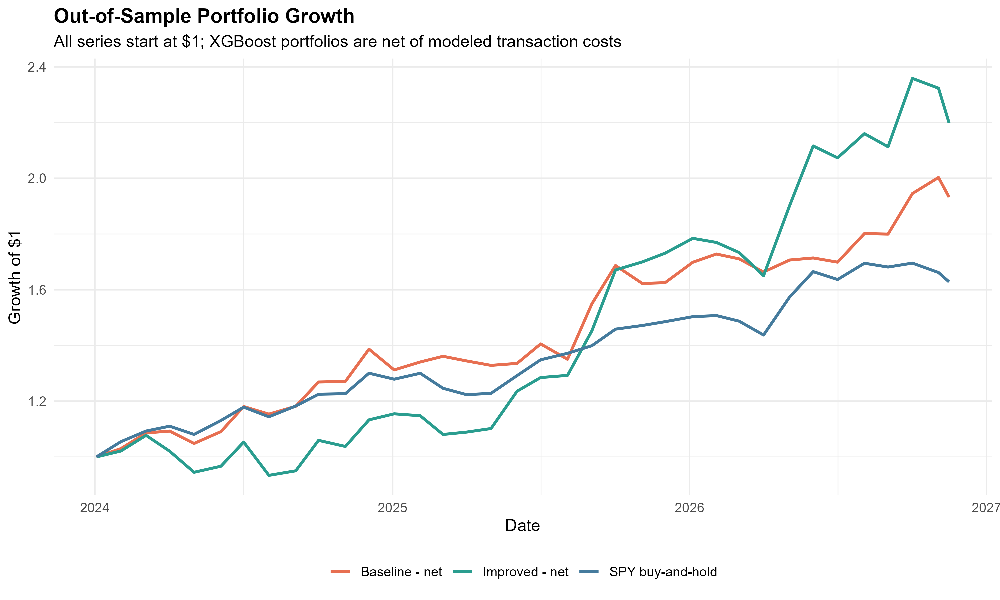
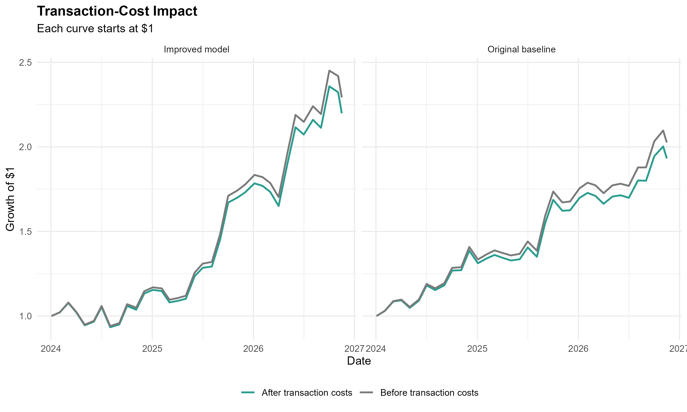

{width="800px"}

## 1. Intuition vs. Financial Indicators: A Class Experiment

In a class exercise, 45 teams of two built two portfolios of $100,000 for a two-month period. One portfolio was chosen by intuition; the other used simple financial indicators, including the Sharpe ratio, Jensen's alpha, and correlations among stocks.

Across teams, the indicator-based portfolios finished $1,909 higher on average, a 1.89% premium. The two portfolio values were moderately correlated ($r = 0.4017$), so teams that did well with one approach tended to do somewhat well with the other.

Because each team supplied both portfolios, we tested the within-team differences. The two-sided paired t-test returned $p = 0.0998$, and a bootstrap 95% confidence interval for the mean difference ran from $-\$298$ to $\$4,119$. Both results include zero, so the exercise does not establish a reliable advantage for financial indicators. A one-sided test gives $p = 0.0499$, but this borderline result does not change the more cautious two-sided conclusion.

This small experiment raises a broader question: can a model identify useful patterns in historical market data?

## 2. Why Stock Returns Are Difficult to Predict

Prices respond quickly to public information, while much of a stock's next move depends on news that has not yet arrived. Daily returns are also noisy, and relationships that appear in one period may weaken when market conditions change. A flexible model can therefore fit past fluctuations without learning a signal that persists.

For that reason, a credible backtest needs a strict time split, careful protection against overlapping future targets, and performance measures that account for trading costs. These principles guide the comparison below.

## 3. The Baseline Model

The class experiment didn't show clear evidence that simple financial indicators outperform intuition. This leads to a new question: can we  build a machine-learning model that used past market data to construct better portfolio?

The orginal model provided for this assignment uses **XGBoost**to forecast each stock's return over the next 20 trading days. It uses daily prices for a fixed group of large U.S. companies and the S&P 500 ETF (SPY), then creates features such as momentum, rolling volatility, short-term reversal, and market-adjusted returns. It trains on observations dated before January 2024 and evaluates predictions from January 2024 onward. Each month, it ranks stocks by predicted return, selects the top ten, and compares their performance with SPY.

The original run reported a high annualized Sharpe ratio of **10.9** and alpha of **7.9507**, with identified set of 10 top-ranked stocks(**INTC、PFE、CMCSA、MU、VZ、AMD、SCHW、QCOM、CVS、NKE**). However,after reviewing the code, I also found several problems.  First, the cumulative-return chart started the model portfolio and SPY on different dates, so the two series were not directly comparable.

Besides, this model also included raw dollar prices and volume as features, but these values can make tree splits depend on arbitrary price levels rather than comparable changes in performance. The one-month momentum formula was also reversed, which means it divided an older price by a more recent one. In addition, the training split didn't remove observations whose 20-day target window crossed into the test period. Finally, weights were assigned in proportion to positive predicted returns, which could give a large position to a volatile stock, and the backtest didn't charge trading costs.

## 4. Improved Model

### Model Building 

The improved model keeps the legacy features and XGBoost settings in the baseline so it remains a useful comparison. It corrects the evaluation design and revises  features. The main changes are summarized below.

| Issue in the initial workflow | Treatment in the updated comparison |
|:--|:--|
| Monthly returns scaled with daily annualization factors; benchmark and portfolio started on different dates | Recalculate performance from the same out-of-sample holding periods and align all series at $1 |
| Raw levels, reversed legacy momentum, and training targets overlapping the test boundary | Retain legacy predictors only for the baseline; use relative features in the improved model and purge overlapping targets for both |
| Predicted-return weights, no position cap, and no trading costs | Apply the same prediction-based allocation rule to both models and charge the same trade cost |

Apart from that, I also tuned the improved model's hyperparameters to improve its generalization and portfolio performance. I tested 16 combinations of tree depth, learning rate, minimum child weight, and L2 regularization using three purged walk-forward validation windows. 

To balance both predictive performance and economically meaningful investment performance, candidates were ranked primarily by validation portfolio **Sharpe ratio**, followed by **mean portfolio return**, **Rank IC**, and **RMSE**. The selected configuration uses a **maximum tree depth of 2**, a **learning rate of 0.05**, a **minimum child weight of 10**, and an **L2 regularization parameter of 20**, achieving the highest validation Sharpe ratio. However, the tuning results cover only five monthly portfolio returns, so these parameters should be viewed as a sample-dependent choice rather than a universally optimal configuration.

I also incorporated **transaction costs** when constructing the improved model, setting them at **10 basis points per dollar of turnover**. Turnover is calculated as the sum of absolute changes in portfolio weights, capturing both purchases and sales. The same rule is applied to both models, and results are reported both before and after costs.

### Predictive Performance

The backtest contains 35 monthly holding periods, from the first execution on January 3, 2024 through the final holding-period end on November 16, 2026. SPY is measured over those same dates.

RMSE and MAE measure forecast error for the 20-day return, so lower values are better. Directional accuracy is the share of predictions with the correct return sign. Mean daily Rank IC is the average Spearman correlation between predicted and realized returns across stocks, with higher values indicating better ranking.

| Model | RMSE | MAE | Directional accuracy | Mean daily Rank IC |
|:--|--:|--:|--:|--:|
| Original XGBoost baseline | 9.40% | 6.86% | 52.17% | 0.0328 |
| Improved XGBoost | 9.01% | 6.55% | 51.71% | 0.0369 |

From above, we can see that improved model reduces RMSE by about 4% and MAE by about 4.5%, and raises mean daily Rank IC from 0.0328 to 0.0369. Its directional accuracy is slightly lower. The gains are modest: the model ranks stocks somewhat better, but it remains difficult to predict the sign and size of individual stock returns.

### Portfolio Performance

| Strategy | Cumulative return | Ending value of $1 | Annualized Sharpe Ratio | Annualized market-model intercept | Beta | Maximum drawdown |
|:--|--:|--:|--:|--:|--:|--:|
| SPY buy-and-hold | 62.82% | $1.63 | 1.57 | 0.00% | 1.00 | -5.93% |
| Original XGBoost, gross | 102.64% | $2.03 | 1.62 | 12.61% | 0.75 | -5.25% |
| Original XGBoost, net | 93.23% | $1.93 | 1.52 | 10.91% | 0.75 | -5.38% |
| Improved XGBoost, gross | 129.28% | $2.29 | 1.35 | 2.92% | 1.63 | -12.87% |
| Improved XGBoost, net | 119.88% | $2.20 | 1.29 | 1.47% | 1.63 | -13.33% |

After modeled costs, the improved portfolio grows $1 to $2.20, ahead of the baseline at $1.93 and SPY at $1.63. But that higher cumulative return comes with greater market exposure and a deeper drawdown: the improved model's beta is 1.63 and its maximum drawdown is 13.33%, compared with 0.75 and 5.38% for the net baseline. Its Sharpe measure is also lower than the baseline's and SPY's. The improved model leads in total return, but not in risk-adjusted performance.

Modeled transaction costs reduce cumulative return by about 9.4 percentage points for each active strategy. The effect depends on how much the portfolio changes at each rebalance, even with a cost assumption of only 10 basis points per dollar traded.

{width="800px"}

{width="800px"}

### Latest Improved-Model Ranking

The latest prediction snapshot, dated November 16, 2026, ranks these stocks highest. Predicted returns refer to the model's 20-day target. Weights follow the positive predictions and are not capped.

| Rank | Ticker | Predicted 20-day return | Portfolio weight |
|--:|:--|--:|--:|
| 1 | INTC | 9.21% | 20.95% |
| 2 | MU | 5.93% | 13.49% |
| 3 | NVDA | 5.02% | 11.42% |
| 4 | AMAT | 3.95% | 8.98% |
| 5 | NOW | 3.95% | 8.98% |
| 6 | AMD | 3.75% | 8.52% |
| 7 | AVGO | 3.04% | 6.92% |
| 8 | BA | 3.04% | 6.92% |
| 9 | BKNG | 3.04% | 6.92% |
| 10 | CAT | 3.04% | 6.92% |

### limitations of the improved model

Despite its improvements, the model still has several limitations.

First, the improved features modestly reduce forecast error and drives a higher cumulative return in this sample, but it also earns a higher cumulative return in this sample, the resulting portfolio takes on greater market exposure, suffers a larger drawdown, and yields a lower Sharpe ratio. Besides, The test also covers only 35 holding periods, and hyperparameter tuning relies on just five monthly portfolio returns, limiting the reliability of the results. Finally, the transaction-cost model uses a fixed rate and does not account for bid-ask spreads or market impact. Results from this period may also not hold under different market conditions.

